## What We Found 

Well, this is a little human mistake in the project implementation phase .We have large campus network project ongoing , one of our engineer is response to pre-config the ERSPAN function in each building distribute switch to capture the traffic that come form the access level switch then send to core switch which connected to a monitor platform.

After day by a day this green field become to production stage , more and more traffic came from the access layer. Then in one day we found the core switch have a high CPU utilization alarm in the log buff , even the SSH remote control be come jitter and delay.

We use "monitor capture" to see what kind of traffic is sent to the device and noticed these traffics is coming from each distribute switch and the packet looks like very normal which destination IP is core switch. 

In the first place we confusing is the core switch performance can not handle such ERSPAN made it high CPU ? So we checked the Cisco ERSPAN guide and that is said ERSPAN traffic doesn't offload by the CPU level ... Humm.. make senses....

## Two source sessions, one matching ID

So , looks like don't know what reason to make this happen , then we started to review a few switches ERSPAN config snippet , like this:

| Core Switch      | Distribute Switch |
| ----------- | ----------- |
| monitor session 1 type erspan-destination<br/> destination interface Gi2<br/> source<br/>  erspan-id 101<br/>  ip address 198.51.100.2 | monitor session 1 type erspan-source<br/> source interface Gi1 rx<br/> destination<br/>  erspan-id 101<br/>  mtu 1464<br/>  ip address 198.51.100.2<br/>  origin ip address 198.51.100.1<br/><br/>monitor session 2 type erspan-source<br/> source interface Gi3 rx<br/> destination<br/>  erspan-id 102<br/>  mtu 1464<br/>  ip address 198.51.100.2<br/>  origin ip address 198.51.100.1 |


Ok , in the distribution switch we found there is two monitor session on it with difference erspan-id . After we remove the named is test one , show CPU utilization in the core switch is coming to cut back on.


## What still needs verification

Why the ERSPAN traffic will send to the CPU if there is not ERSPAN-ID match ? I check the Configuration Guide again and there is note in it:

> Because encapsulation and decapsulation are performed in the hardware, the CPU performance is not impacted.

ERSPAN use GRE tunnel to encapsulate the traffic to the destination and decapsulate by hardware , the reason we assumed the device doesn't use hardware offload which is didn't identify the traffic is coming from the ERSPAN session and how to identify the ERSPAN session (or tunnel) is by the ERSPAN-ID , below is the ERSPAN-ID purpose explant in configuration:

> Configures the ID used by source and destination sessions to identify the ERSPAN traffic, which must also be entered in the ERSPAN destination session configuration.

If destination device didn't identify the ERSPAN traffic , which mean it will accept all these traffics and send to CPU due to the GRE tunnel outer IP is itself. But is this the really root cause ? or just a assumption.


##	Trying to Reproduce It in CML

On this section , I will try to reproducing this mistake in my CML lab and I don't think we can 100% reproducing due to a virtual device doesn't have hardware to "hardware offload" , right?

But I think if the ERPSAN-ID mis match is the root cause of this incident , in the Lab we should see two ERSPAN streams coming from the ERSPAN Source in the Destination.

Here is the diagram :

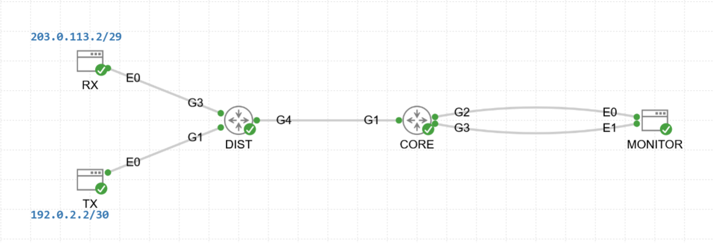

*Figure 1. Lab diagram.*


Here is the ERSPAN config snippet in DIST and CORE Node:

| Core Switch                                                  | Distribute Switch                                            |
| ------------------------------------------------------------ | ------------------------------------------------------------ |
| monitor session 3 type erspan-destination<br/> destination interface Gi2<br/> source<br/>  erspan-id 101<br/>  ip address 198.51.100.2 | monitor session 1 type erspan-source<br/> source interface Gi1 rx<br/> destination<br/>  erspan-id 101<br/>  mtu 1464<br/>  ip address 198.51.100.2<br/>  origin ip address 198.51.100.1 |
| monitor session 4 type erspan-destination<br/> destination interface Gi3<br/> source<br/>  erspan-id 102<br/>  ip address 198.51.100.2 | monitor session 2 type erspan-source<br/> source interface Gi3 rx<br/> destination<br/>  erspan-id 102<br/>  mtu 1464<br/>  ip address 198.51.100.2<br/>  origin ip address 198.51.100.1 |


### What I will do ?

I will use iPerf to generate traffic between RX node and TX node , DIST switch will work as a ERSPAN source to span these traffics to the CORE, and 	CORE will then forward the mirrored traffic to MONITOR node .

Start the iPerf server processes on RX and TX:

```sh
iperf -s -u -B 203.0.113.2 -p 5001 -i 1 &
rx_server=$!
```

```sh
iperf -s -u -B 192.0.2.2 -p 5002 -i 1 &
tx_server=$!
```


Start packet captures on the following links:

| Link | Capture filter（BPF） | What to check |
| --- | --- | --- |
| DIST Gi4 → CORE Gi1 | `ip proto 47` | Expand the ERSPAN header and check for IDs 101 and 102 |
| CORE Gi2 → MONITOR eth0 | `udp dst port 5001` | Decapsulated flow A |
| CORE Gi3 → MONITOR eth1 | `udp dst port 5002` | Decapsulated flow B |
| DIST Gi3 ↔ RX eth0(Option) | `udp dst port 5001 or udp dst port 5002` | Check that both directions of business traffic are still flowing |


### How to verify it

Run flow A on TX. Use the same commands with each flow sending at a target rate of 100 kbit/s for 10 seconds.

```sh
iperf -c 203.0.113.2 -u -B 192.0.2.2 -p 5001 -b 100k -l 256 -t 10
```

Run flow B on RX. You can use two consoles to start the flows at roughly the same time.

```sh
iperf -c 192.0.2.2 -u -B 203.0.113.2 -p 5002 -b 100k -l 256 -t 10
```

TX and RX should each receive the UDP traffic sent by the other node. With this configuration, I should see both flows, UDP 5001 and UDP 5002, inside ERSPAN packets on the DIST Gi4 → CORE Gi1 link. 

After CORE decapsulates them, UDP 5001 should appear on CORE Gi2 → MONITOR eth0, and UDP 5002 should appear on CORE Gi3 → MONITOR eth1.

After I removed the monitor session 4 in Core node

```text
configure terminal
no monitor session 4
end
show monitor session all
```

Start new captures and send both flows again from TX and RX. If the mismatch behaves as expected, CORE Gi1 should still receive ERSPAN IDs 101 and 102, while MONITOR receives UDP 5001 on eth0 and no UDP 5002 on eth1. Also check the business link to confirm that both UDP flows between TX and RX are still working.


### Results and Conclusions

Before we remove monitor session 4 in core , capture the packet in link "DIST Gi4 → CORE Gi1":

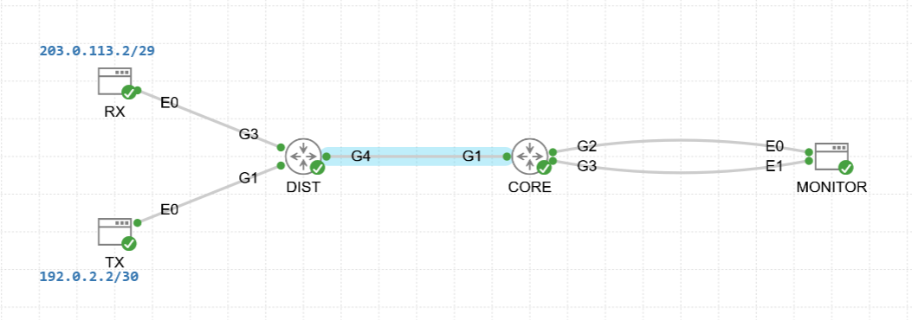


The capture shows both UDP flows between RX and TX, using destination ports 5001 and 5002:

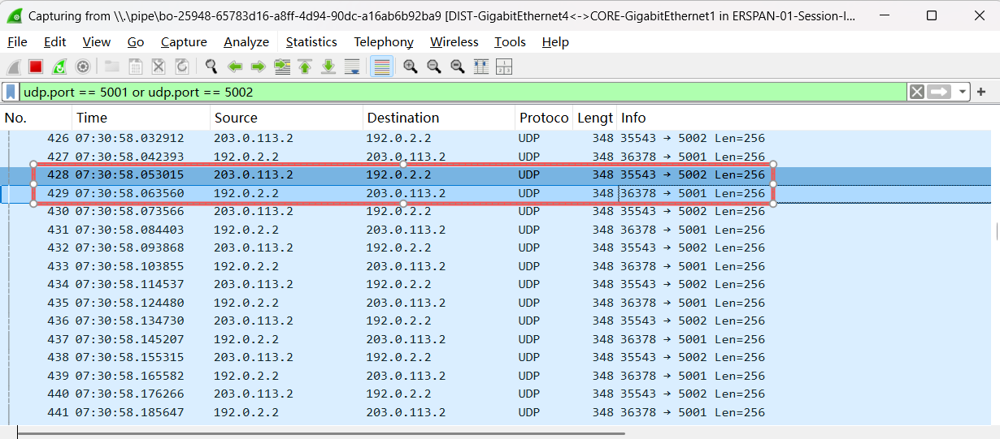

Looking at the packet details, we can see the outer IP header followed by GRE and ERSPAN. The outer source and destination IP addresses match the addresses in our ERSPAN configuration.

UDP Flow 5001 ：

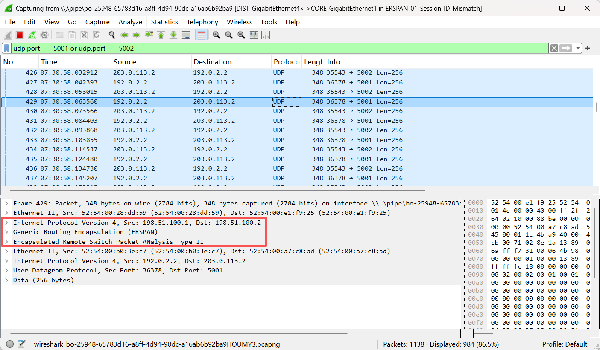


UDP Flow 5002：

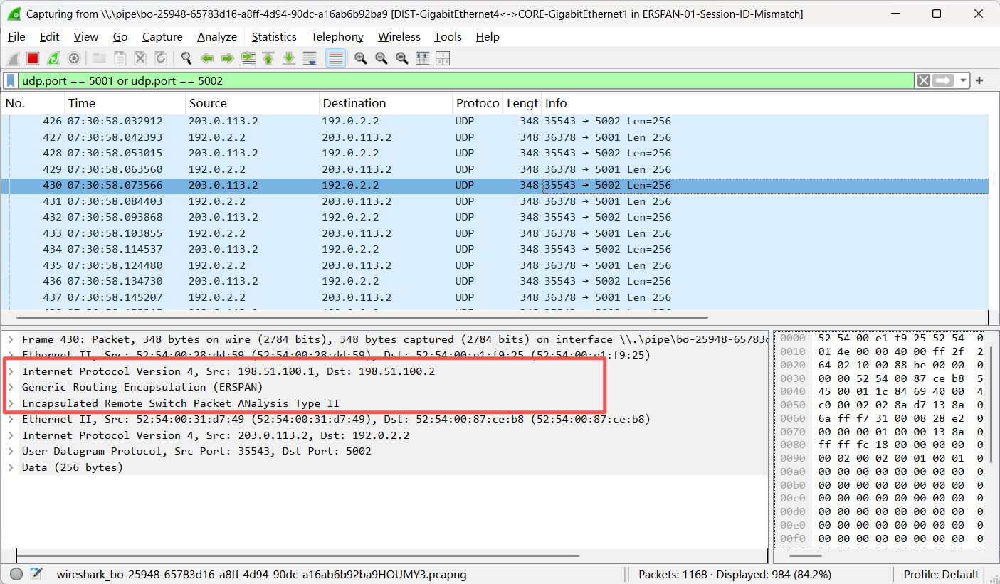

Next, let's check the captures on the two links between CORE and MONITOR:

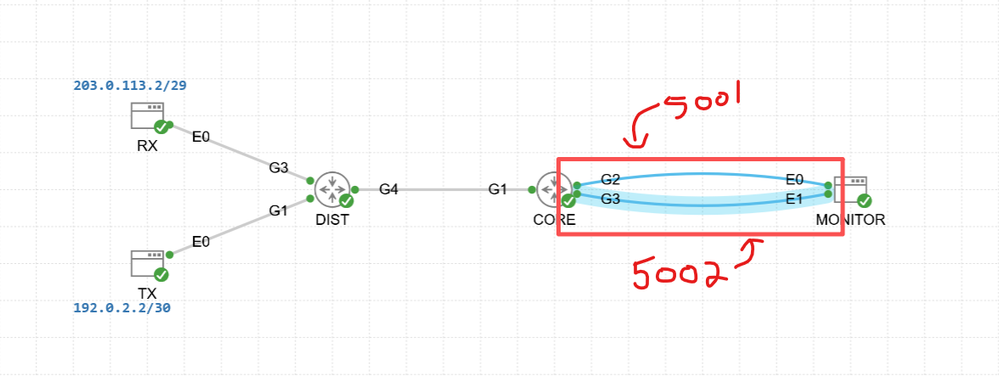

Link "CORE Gi2 → MONITOR eth0" :

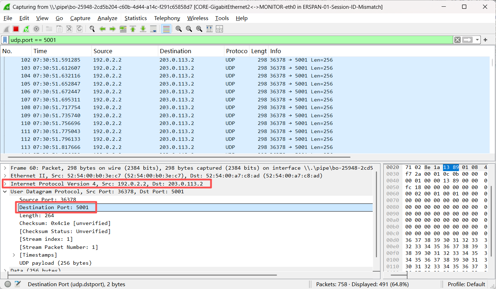


Link "CORE Gi3 → MONITOR eth1" :

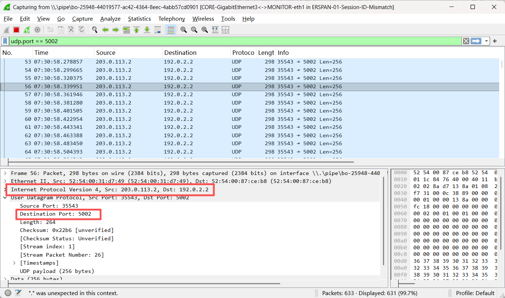


Remove ERSPAN 4 in Core and test again:

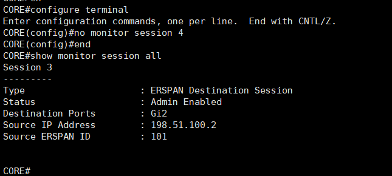

At this time we still can observe there is two UDP flow in Link "DIST Gi4 → CORE Gi1:

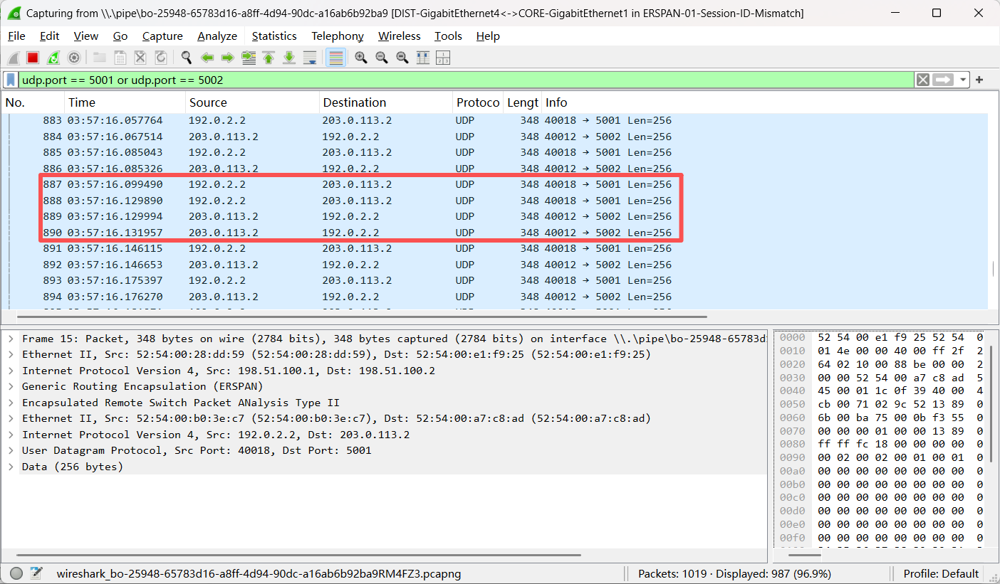


And in the Link "CORE Gi2 → MONITOR eth0", UDP Flow 5001 ：:

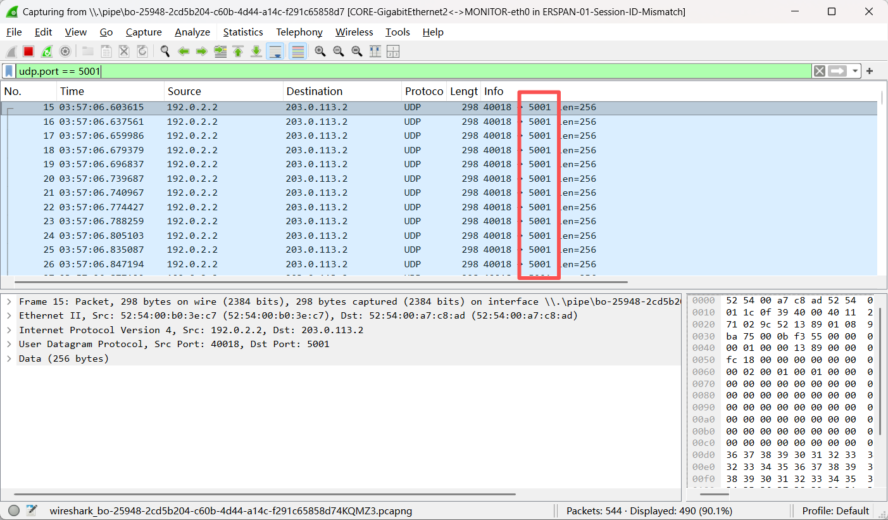


But in Link "CORE Gi3 → MONITOR eth1", no any traffic through it :

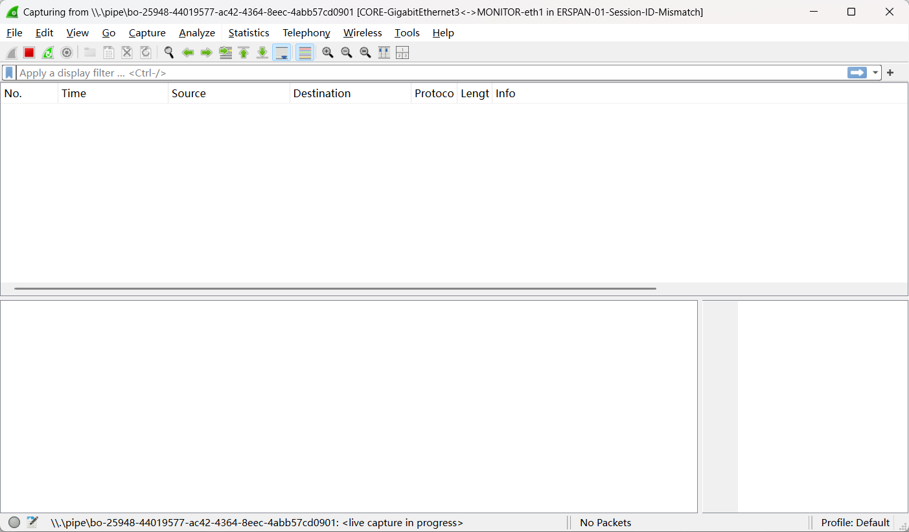


So far, we can see that CORE has stopped sending one of the mirrored flows to MONITOR. But what actually happened to those packets inside CORE? On IOS XE, we can use Packet Trace to follow the datapath processing and see the final action taken on a packet. Comparing the traces and drop counters with and without a matching destination session should give us a better idea of where the packets are being dropped.


Set up Packet Trace on CORE:

```
configure terminal
ip access-list extended ERSPAN_TRACE
 permit gre host 198.51.100.1 host 198.51.100.2
end

debug platform condition interface GigabitEthernet1 ipv4 access-list ERSPAN_TRACE ingress
debug platform packet-trace packet 64 fia-trace
debug platform packet-trace copy packet both size 512

show platform conditions
show platform packet-trace configuration

debug platform condition start
```

On RX, start with a small flow at 10 kbit/s for 5 seconds:

```
iperf -c 192.0.2.2 -u -B 203.0.113.2 -p 5002 -b 10k -l 256 -t 5
```

Then go back to CORE and check the trace results:

```
debug platform condition stop

show platform packet-trace statistics
show platform packet-trace summary
show platform packet-trace packet 0
```

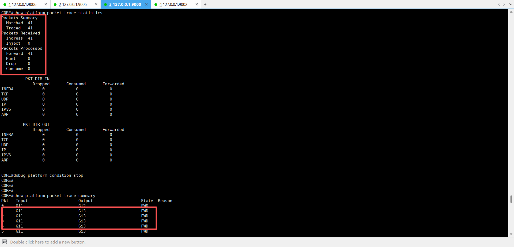

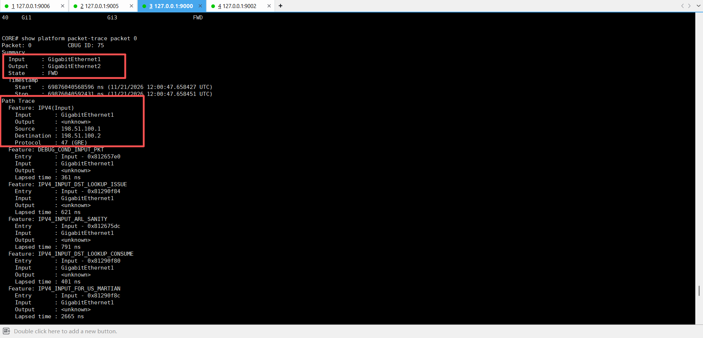

In this round, all 41 traced packets show FWD. Then I removed ERSPAN destination session 4 from CORE again and repeated the trace. Here are the results.

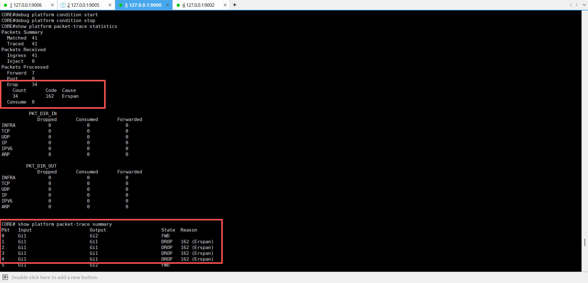

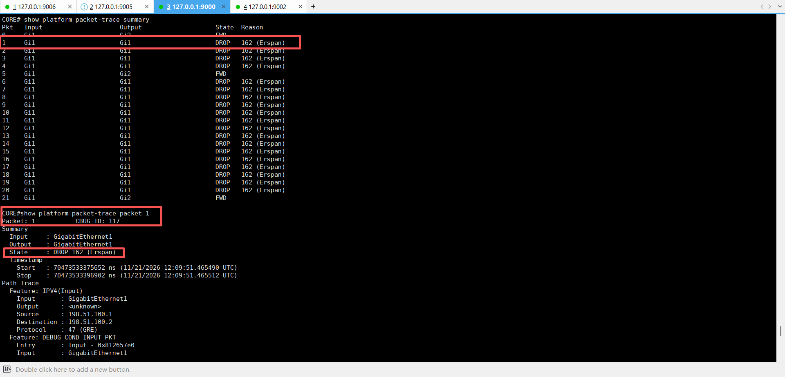


I looked up what the four actions under Packets Processed mean:

| Action             | Meaning                                                      | Refer to the Lab                                             |
| ------------------ | ------------------------------------------------------------ | ------------------------------------------------------------ |
| **Forward / FWD**  | The packet has been queued for forwarding through an output interface. | Traffic with ERSPAN ID 101 was decapsulated and forwarded through Gi2. |
| **Punt / PUNT**    | The packet is sent from the data plane to the control plane for further processing by the RP or IOSd. | The punt count was 0.                                        |
| **Drop / DROP**    | The forwarding processor drops the packet, usually with a reason code. | Traffic with ERSPAN ID 102 showed `DROP 162 (Erspan)`.       |
| **Consume / CONS** | A feature consumes the packet during processing, ending that packet's processing path. | Cisco gives examples involving ICMP and cryptographic processing. The detailed trace is needed to understand a specific case. |

Final, here are three things I took away from this lab：

1. if ERSPAN destination wasn't configured in destination device , it will dropped these traffics.
2. Destination can identify the traffic which is the ERSPAN even without a matching destination session .
3. In this lab we couldn't reproduce the phenomenon , the platform and software version may matter.

In the other hand , the source device doesn't have a mechanism to negotiate with the destination before build up the GRE tunnel. So the outcome is the source switch just send the span traffic to destination whatever it want or not , like your Asian parent said all the thing then done just in the name of help , but at least you can argue with your parents. With ERSPAN, you'd better fix the configuration.

That also brought me back to Cisco's advice to configure and verify the destination session before enabling the source. :

> To avoid over-subscription of traffic, which can lead to drop in management traffic on the destination device, ensure that the destination session is configured and is working on the destination device, before configuring a source session on the source device.


*AI tools were used to help correct grammar and spelling in this article.*

## References

- [Cisco Catalyst 9300 ERSPAN Configuration Guide, IOS XE 17.12.x](https://www.cisco.com/c/en/us/td/docs/switches/lan/catalyst9300/software/release/17-12/configuration_guide/nmgmt/b_1712_nmgmt_9300_cg/configuring_erspan.html)
- [Cisco CSR1000v Packet Trace Guide](https://www.cisco.com/c/en/us/td/docs/routers/csr1000/software/configuration/b_CSR1000v_Configuration_Guide/packet_trace.html)